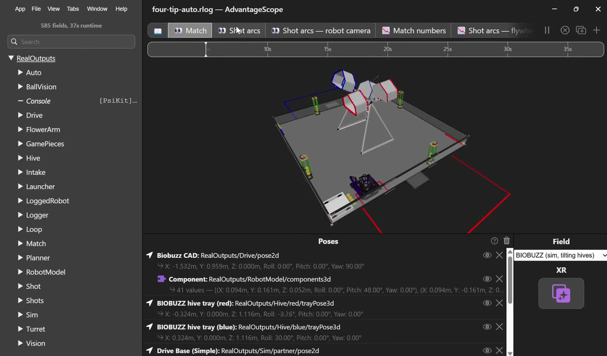
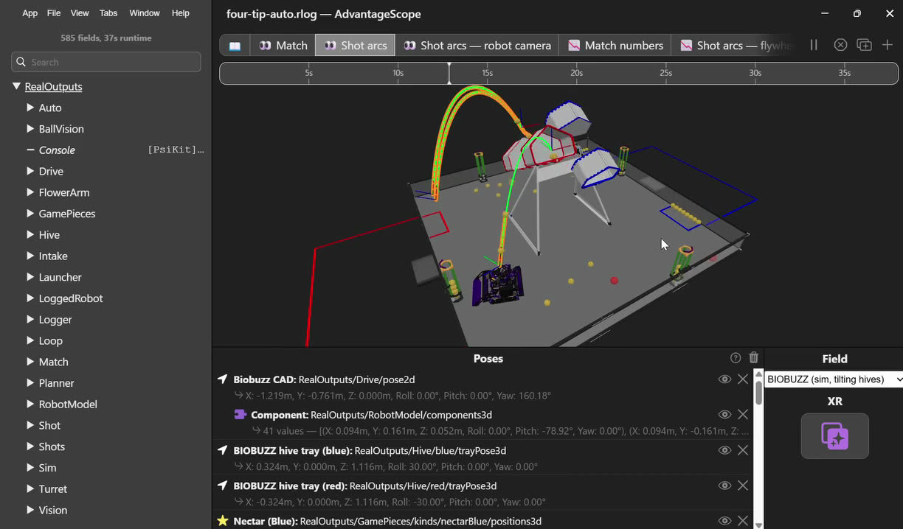
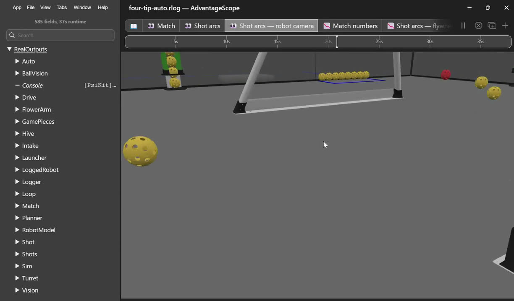
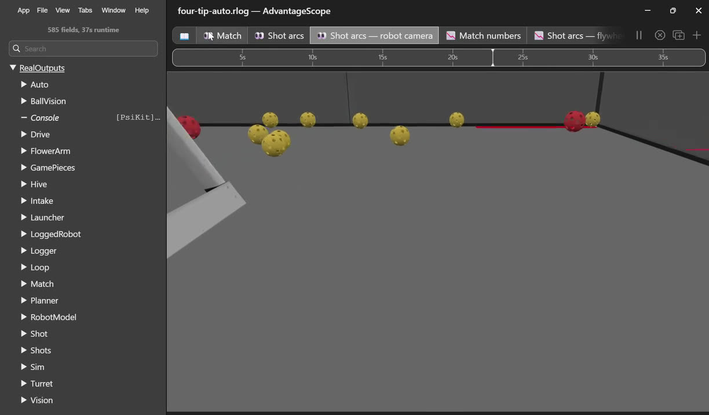
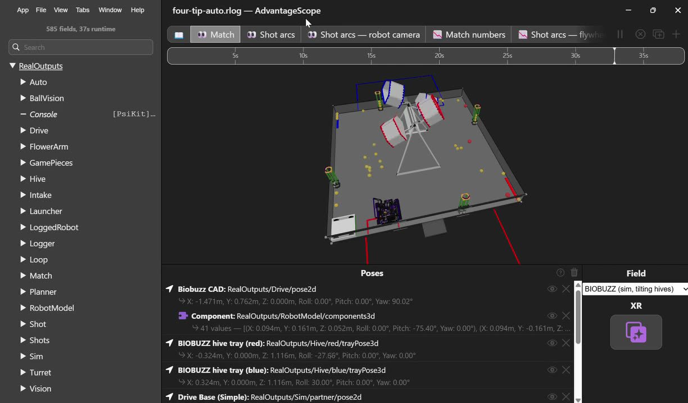
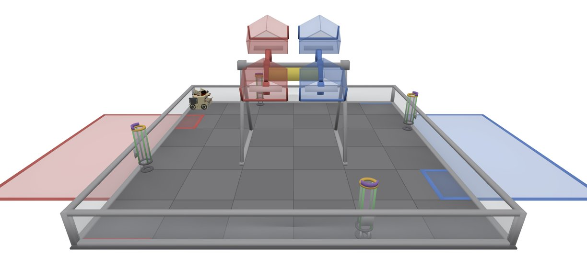

# SimLoop sim: feature parity with the reference AdvantageScope setup

What our SimLoop sim (`TeamCode/src/test/java/org/firstinspires/ftc/teamcode/sim/`) shows in AdvantageScope,
compared with a reference BIOBUZZ setup built on the same library: a screenshot and a 32 s screen recording of a
`four-tip-auto.rlog` (585 fields, 37 s) with tabs Match, Shot arcs, Shot arcs — robot camera, Match numbers and
Shot arcs — flywheel, on a custom field "BIOBUZZ (sim, tilting hives)".

Everything is built, on SimLoop's building blocks (`GamePieceTracker` with hinged
bodies, `ShotArcRecorder`, `StaticRobot`) and our own field assets. The sim's classes:

- `BiobuzzRobotSim`: the robot (devices, drive, turret, flywheel, Limelight) and everything below, logged each tick.
- `SimField`: the world (perimeter, trays, flowers, hive feet, ball masses, air drag), the match's staged balls, the
  zones. `SimHiveTrays`: the tipping trays. `SimLauncher`: intake, storage, feeding, launching, shot arcs.
  `SimMatch`: clock and score. `SimPartner`: the scripted alliance partner. `SimShapes`: convex solids.
- Robot code: `util/MatchLog` and `Robot.log()` log the robot's own state (off on the robot until
  `RobotConstants.Logging.ENABLED`; always in the sim).
- Tests: `AutoSimTest` (every Auto with the partner; the two preloads tip our hive), `BallChaseSimTest` (Ball Chase Test for 30 s on the real ball vision: `SimWebcam` draws the camera's frames; balls scattered over the tiles with `scatter()`), `LauncherSimTest` (TeleOp shoots
  its preload and picks a ball up), `HiveTippingSimTest`, `HiveVisionSimTest`, `BallVisionSimTest`, `TeleOpSimTest`, `SoloCarrySimTest` (the Solo Carry Auto with a partner that only parks and the Pinpoint's IMU drifting 0.5°/s: one tip, 3 more in the new up cell, both parked, 36 AUTO points; the fused pose 0.2 in off on average, the Pinpoint alone 6.6. Then 25 scenarios, and 10 varied matches (`vary`: gardens laid by hand, the partner parking short, camera misses, shot scatter; the partner is solid to us): set down off its start, a sagging battery with balls taking speed off the flywheel (`flywheelLoad`), the Limelight losing all tags in bursts of up to 1 s a fifth of the time (`flickerLimelight`), once with the preload missing the tip, a drive like a real mecanum's (`BiobuzzRobotSim(true)`: 85% speed, strafing 80%, 150 in/s² of grip), scattered and wild shots (`shotSpread`), every shot 5% slow or fast (`shotBias`), the ball camera at a Control Hub's 10 frames a second, 100 ms late, missing 30% of balls (`ballCamera`), a short preload, no tags or a Limelight that stops seeing partway (`blindLimelight`), blue, together: 39 to 47 points, all parked). The flowers' staged pollen is put to sleep so it stays stacked until disturbed (it used to roll out before the match), `HiveTagsSimTest` (the filter's tag geometry against the fake Limelight's: identical).
  Logs land in `TeamCode/build/sim/*.rlog`.
- Ball camera frames: the balls have wiffle holes painted on (`WiffleHoles`: 26 holes, about a fifth of the diameter each, rolling with the ball), in `SimWebcam` and `BallVisionSimTest`.
- Pose from the hive's tags: `core/PoseFilter` (unit tested in `core/PoseFilterTest`) runs in `pedro/FusedLocalizer`, the drivetrain's localizer; `HiveVision` hands it every hive tag the Limelight sees. In the sim the tags follow the arms' real angles every tick, the arms rest a little short of 30° and not the same each way or on each hive (`SimHiveTrays.STOPS`, for the shock absorbers), and `imuDrift(degreesPerSecond)` drifts the Pinpoint's heading (its pods still count the true motion). The fake Limelight captures at the end of a tick from the pose it was given at the start, so `BiobuzzRobotSim` gives it the turret's pose carried one tick ahead, and its latencies are whole ticks (a frame only becomes available on a tick): then a frame is as old as `staleness` plus the reported latencies say, as on the robot (a SimLoop issue to file). Logged: `Drive/odometryPose` (the Pinpoint alone) beside `Drive/pose`, and `Localization/*`.
- Real frames: `vision/RealFramesTest` scores the robot's ball vision (the Java `BallVisionProcessor`) on biobuzz_detection's 329 hand-labeled Arducam frames, as its `evaluate.py` does. Oct 28: recall 63.9%, precision 99.2% (the Python reference: 66.0%, 99.0%); 84% recall on the plain pollen video, 52% on the crowded, blurred handheld one; 21.5 ms median per frame on a Mac. Skipped when the dataset isn't next to this repo.

Status: ✅ done, 🟡 partly, ❌ not yet. Updated as each item is built.

| Feature in the reference | Ours | What it takes | Size |
|---|---|---|---|
| Robot against the field (`Sim/Touching`) | ✅ the chassis footprint stops at the four walls, the hive's foot bars and the flower columns and slides along them, and can't turn where turning would swing it into one (`BiobuzzRobotSim.collide`, SimLoop `FootprintContact`); the Pinpoint reads the stopped pose. `Sim/Touching` names what it's against | Not solid to the robot: the hive trays, the partner robot | |
| Robot CAD model on the field | ✅ `Robot_BIOBUZZ` AdvantageScope asset from the CAD master assembly | done | |
| Articulated robot (`RobotModel/components3d`) | ✅ turret: `Robot_BIOBUZZ` has the `04 - Launcher` subassembly as component 0 (`model_0.glb`), turning about the turret axis; `BiobuzzRobotSim` logs its pose from the simulated turret angle. Theirs has 41 components, including the drive wheels spinning (four at (±0.094, ±0.161, 0.052) m, pitch changing as they roll) | done (turret); wheels and intake rollers not split out | Medium |
| Game pieces on the field (`GamePieces/kinds/*/positions3d`) | ✅ the match's staging (`SimField.stage`): 4 pollen stacked in each flower (a tube open underneath, so the bottom one can be taken), 4 in a row in each garden, 3 nectar in each up cell; 4 preload pollen in the robot. The intake takes pollen that reaches its mouth while it runs (up to 4), never nectar (too big for it); the robot pushes the others; balls roll, collide and spill from a tipped cell | Not staged: the 5 nectar in each alliance area (no human player). Storage 4, intake and feed rates are PLACEHOLDERS | |
| Shot arcs, intended vs flown (`Shots`) | ✅ with the gate open and the intake running, stored balls feed one every 0.25 s and leave the turret at `HOOD_ANGLE`, as fast as the flywheel really spins (`FLYWHEEL_TICKS_PER_EXIT_SPEED`), with the robot's motion. Last 3 shots kept: flown (orange) beside the arc that would have gone through the middle of the up cell's opening from the same launch (green), and `Shots/missInches/*` | SimLoop flies balls with gravity and drag and no lift, as `ShotSolver` now does (`LIFT_COEFFICIENT` 0: the counter-rollers leave no spin); fit the drag to real shots. In `AutoSimTest` the Autos shoot their preload into the up cell (with the partner's, 11 balls, and it tips) | |
| Tilting hives (`Hive/red/trayPose3d`, `Hive/blue/trayPose3d`; field "BIOBUZZ (sim, tilting hives)") | ✅ trays tip from the weight in their up cell: each is a SimLoop `KinematicBody` with `HingeDynamics` (`SimHiveTrays`), logged at its real angle; balls in the cell that comes down roll out. `HiveTippingSimTest`: 7 pollen hold, 8 tip (1.6 s after the 8th lands), 3 pollen + 3 nectar tip, a TeleOp run tips red twice. Drawn on our field "BIOBUZZ Sim (tilting hives)" with "BIOBUZZ Hive Red/Blue" tray models (`tools/advantagescope/build_sim_field.py`) | The tray's mass, inertia and damping are PLACEHOLDERS tuned to the Field Setup Guide's counts. The Limelight's AprilTags move with the tray, every tick it turns (by reflection into `FakeLimelight3A`, which has no way to change its layout). The rest angles (`SimHiveTrays.STOPS`) are PLACEHOLDERS | |
| Simulated alliance partner (`Sim/partner/pose2d`) | ✅ `SimPartner` (opt in with `withPartner()`): an 18 in robot that drives from its wall to a spot in front of the up cell, shoots its 4 preload pollen in, and parks in the loading zone; balls bounce off it, and so do we (it is solid to our robot). In `AutoSimTest` its 4 pollen and ours land on the 3 staged nectar and tip our hive. `withParkingPartner()`: it starts in our LEFT corner and only parks (`SoloCarrySimTest`) | Scripted, not reactive: it doesn't intake, and it drives through our robot | |
| Zone outlines on the field | ✅ `Field/zones/*` (loading zones, gardens, alliance areas) as trajectories; also taped on our field model | Not outlined: the AUTO halves (the center line) | |
| "Robot camera" tab (view from the robot) | ✅ `Robot_BIOBUZZ` config has the webcam (70.3° from its calibration, by the intake) and the Limelight as AdvantageScope cameras (copy in `tools/advantagescope/Robot_BIOBUZZ.config.json`); `Sim/Camera/webcam` and `Sim/Camera/limelight` log both as poses, the Limelight turning with the turret | AdvantageScope's robot cameras are fixed to the chassis, so its Limelight view is the turret centered | |
| Match tab / "Match numbers" tab (timer, score) | ✅ `SimMatch`, `Match/*`: period and time left (an Auto run is the 30 s AUTO, anything else the 2:00 TELEOP; the clock starts with the OpMode), and per alliance tips (20), balls in the up cell (2) and in the garden (1), robots that left the wall (3, AUTO) and parked in the loading zone (5), and the score as if the period ended now: an Auto run scores tips, LEAVE and PARK only, as the manual does (Table 10-2, 10.5: cells and the garden count at the end of the match); its cell and garden balls are still logged | Not counted: flowers, fouls, ranking points | |
| "Shot arcs — flywheel" tab | ✅ "Flywheel" tab: the robot code's `Launcher/flywheelTarget` against `Launcher/flywheelActual`, `Sim/ShotsFired` and `Sim/BallsHeld`, with `Launcher/status` and `Gate/open` as stripes | | |
| Robot-side logs (`Auto`, `BallVision`, `Drive`, `Intake`, `Launcher`, `Loop`, `Planner`, `Shot`, `Turret`, `Vision`, …) | ✅ `Robot.log()` records `Drive/*`, `Launcher/*`, `Turret/*`, `Shot/*`, `Intake/*`, `Gate/open`, `Vision/*`, `BallVision/balls`, `Robot/alliance`, `Robot/hive` and `Loop/ms` each loop of TeleOp and Auto (`util/MatchLog` runs PsiKit). Always in the sim's logs. On the robot only with `RobotConstants.Logging.ENABLED` (off for now), which writes `FIRST/data/logs/<OpMode>-<time>.rlog` | PsiKit is now an `implementation` dependency, so it ships in the APK even while off. Not logged: the Auto routine's steps and the path planner (`Auto`, `Planner` in theirs) | |
| Saved multi-tab layout | ✅ `tools/advantagescope/sim-layout.json` (File → Import Layout): Match, Shot arcs, Robot camera (webcam), Match numbers, Flywheel | | |
| `FlowerArm` | n/a | That robot has one; BIOBUZZ doesn't | |

## Reference frames

From the screen recording, in `doc/media/`.

| | |
|---|---|
|  |  |
| Match tab, 2 s: both hive trays tilted, flower columns stacked with pollen, zone outlines | Shot arcs, 10 s: the last shots' intended and flown arcs into the red hive |
|  |  |
| Robot camera, 18 s: pollen just ahead of the intake | Robot camera, 20 s: across the field, garden row and loose balls |
|  |  |
| Match tab, 30 s: after several tips, balls spilled across the field | Ours: the sim field with both trays, rear cells up (`hive-vision.rlog`) |

## Our AdvantageScope assets

- The sim's flywheel reaches 1 / `FLYWHEEL_KV` ticks/s at full power, the speed the flywheel tuner measured, so
  `FlywheelController` drives it as it drives the real one. The battery is a fixed 12 V (`FakeVoltageSensor`).
- `Robot_BIOBUZZ`: the robot, from the CAD master assembly (STEP to GLB); the turret is component 0.
- `Field3d_BIOBUZZSim`, `Robot_BIOBUZZ Hive Red`, `Robot_BIOBUZZ Hive Blue`: from `tools/advantagescope/build_sim_field.py`,
  simple shapes to the Competition Manual's dimensions (as BiobuzzSim, the Roblox sim, has them), not the field CAD.
  The field also carries Pollen and Nectar models for `GamePieceTracker`'s positions. Rebuild with
  `python3 tools/advantagescope/build_sim_field.py` (numpy and trimesh); it writes into AdvantageScope's userAssets.
- `tools/advantagescope/sim-layout.json` sets up every tab (File → Import Layout in AdvantageScope); it replaces the
  open layout.
- Replay an Auto in one step: `./replay-auto.sh one_cycle_garden_park` (or the `python3
  tools/advantagescope/replay_auto.py` it calls, with the same arguments) runs it in the sim,
  sets up AdvantageScope's tabs (`sim-layout.json`) and opens the log; with no routine it runs every Auto and puts
  them on one field (`merge_autos.py`: a colored ghost and route per routine); `--blue` for blue, `--no-sim` to reopen
  the last run. It closes AdvantageScope first and replaces its open tabs (the old ones are kept in
  `state-*.json.before-replay`).

## Left

1. Turn on `RobotConstants.Logging.ENABLED` once TeleOp testing starts, and check the loop time it costs.
2. Calibration: tray mass and tip time, storage and feed rates, shot drag, against the real robot and field.
3. Run the sim tests on a JDK other than GraalVM 17.0.12: its JIT once broke `BallPipeline`'s sort (a
   `ConcurrentModificationException` on a local list) 75 s into Chase And Shoot Test; JetBrains' JDK 17 runs it clean.
4. Optional: split the wheels and intake rollers out of the robot model to spin them.
